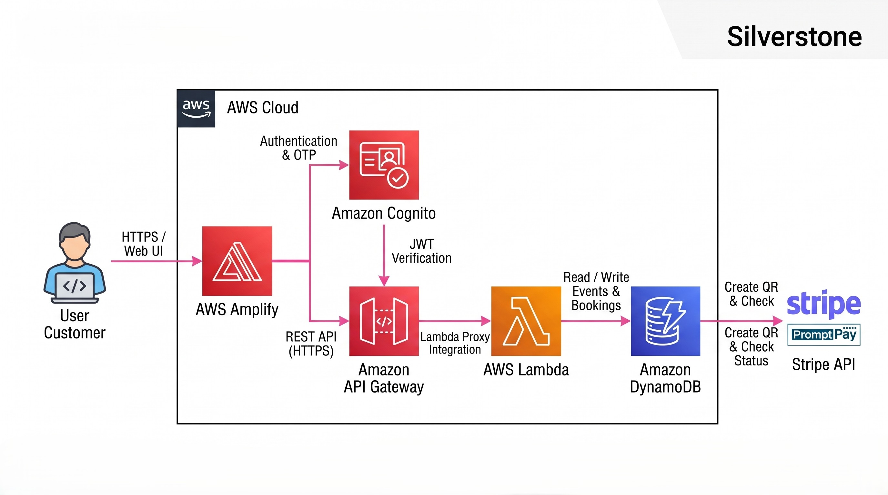

# 🎫 Silverstone Event Ticket Booking

[](https://aws.amazon.com/)
[](https://nodejs.org/)
[](https://www.python.org/)
[](https://stripe.com/)
[](https://tailwindcss.com/)
[](https://www.bu.ac.th/)

ระบบจำหน่ายตั๋วคอนเสิร์ตและอีเวนต์ออนไลน์แบบ **Serverless Cloud Native** เชื่อมต่อระบบชำระเงินอัตโนมัติด้วย **Stripe PromptPay QR Code**

---

## 📑 สารบัญ (Table of Contents)
1. [ฟีเจอร์เด่นของระบบ (Key Features)](#-ฟีเจอร์เด่นของระบบ-key-features)
2. [สถาปัตยกรรมระบบ (Architecture)](#-สถาปัตยกรรมระบบ-architecture)
3. [โครงสร้างโปรเจกต์ (Project Structure)](#-โครงสร้างโปรเจกต์-project-structure)
4. [ข้อกำหนดเบื้องต้น (Prerequisites)](#-ข้อกำหนดเบื้องต้น-prerequisites)
5. [วิธีการติดตั้งและ Deploy ระบบ](#-วิธีการติดตั้งและ-deploy-ระบบ)
   - [วิธีที่ 1: รันสคริปต์อัตโนมัติรอบเดียว (All-in-One)](#วิธีที่-1-รันสคริปต์อัตโนมัติรอบเดียว-all-in-one)
   - [วิธีที่ 2: รันแยกสคริปต์ตามขั้นตอน (Modular Scripts)](#วิธีที่-2-รันแยกสคริปต์ตามขั้นตอน-modular-scripts)
   - [วิธีที่ 3: ติดตั้งด้วยตัวเองผ่าน AWS Management Console](#วิธีที่-3-ติดตั้งด้วยตัวเองผ่าน-aws-management-console)
6. [การตั้งค่าและรัน Frontend](#-การตั้งค่าและรัน-frontend)
7. [รายละเอียด API Endpoints](#-รายละเอียด-api-endpoints)
8. [โครงสร้างฐานข้อมูล (DynamoDB Schema)](#-โครงสร้างฐานข้อมูล-dynamodb-schema)
9. [การลบทรัพยากร (Clean Up)](#-การลบทรัพยากร-clean-up)

---

## ✨ ฟีเจอร์เด่นของระบบ (Key Features)

* **🔐 Authentication & User Management:** ระบบสมัครสมาชิก ล็อกอิน และยืนยันตัวตนด้วย JWT Token ผ่าน **Amazon Cognito**
* **⚡ Real-time Seat/Ticket Stock Management:** คำนวณและตัดสต็อกตั๋วคงเหลือแบบเรียลไทม์บน **Amazon DynamoDB**
* **💳 Automated PromptPay Payment:** สร้าง **PromptPay QR Code** ผ่าน **Stripe API** พร้อมตัวจับเวลาชำระเงินถอยหลัง 10 นาที
* **🎟️ Digital Ticket & QR Verification:** หน้า "บัตรของฉัน" แสดงประวัติการจอง สถานะการจ่ายเงิน และ QR Code สำหรับสแกนเข้างาน
* **📱 Responsive SPA UI:** เว็บแอปพลิเคชัน Single Page Application (SPA) สไตล์โมเดิร์น พัฒนาด้วย Tailwind CSS

---

## 🏗️ สถาปัตยกรรมระบบ (Architecture)

<p align="center">
  
</p>

### รายการบริการบน AWS ที่ใช้งาน:
| บริการ (Service) | ชื่อทรัพยากร (Resource Name) | หน้าที่ |
| :--- | :--- | :--- |
| **Amazon DynamoDB** | `Events_Table`, `Bookings_Table` | ฐานข้อมูลจัดเก็บข้อมูลอีเวนต์และประวัติการจอง |
| **Amazon Cognito** | `Silverstone-Users` / `Silverstone-WebClient` | จัดการ Authentication, User Directory และ Access Token |
| **AWS Lambda** | `Silverstone-Backend` | Compute Engine (Node.js 20.x) รัน Business Logic ทั้งหมด |
| **Amazon API Gateway** | `Silverstone-API` | REST API เชื่อมต่อ Frontend เข้ากับ Lambda พร้อมตรวจสอบสิทธิ์ |
| **AWS Amplify** | `Silverstone` (Web App) | บริการ Web Hosting สำหรับโฮสต์ Static Frontend |

---

## 📂 โครงสร้างโปรเจกต์ (Project Structure)

```text
Silverstone/
├── backend-lambda/                  # โค้ด Backend รันบน AWS Lambda
│   ├── index.js                     # โค้ดหลัก (Node.js 20 + AWS SDK v3 + Stripe Fetch)
│   └── seed-events.json             # ข้อมูลอีเวนต์เริ่มต้นสำหรับทดสอบระบบ
│
├── frontend-html/                   # หน้าบ้าน Single Page Application
│   ├── index.html                   # ไฟล์ UI หลัก (HTML5 + Tailwind CSS + Vanilla JS)
│   └── config.js                    # ไฟล์เชื่อมต่อ Environment ของ AWS
│
├── scripts/                         # สคริปต์ Python Automation (Boto3)
│   ├── deploy_aws.py                # สคริปต์ติดตั้งระบบทั้งหมดแบบ All-in-One
│   ├── destroy_aws.py               # สคริปต์ลบทรัพยากรทั้งหมดบน AWS
│   ├── step1_dynamodb.py            # สคริปต์สร้างตาราง DynamoDB & นำเข้า Seed Data
│   ├── step2_cognito.py             # สคริปต์สร้าง Cognito User Pool & App Client
│   ├── step3_lambda.py              # สคริปต์สร้าง/อัปเดต Lambda Function
│   ├── step4_apigateway.py          # สคริปต์สร้าง REST API และเชื่อม Routes ทั้งหมด
│   └── step5_frontend.py            # สคริปต์อัปเดต config.js และสร้าง frontend-html.zip
│
├── docs/                            # เอกสารคู่มือการติดตั้งแบบละเอียด
│
└── README.md                        # ไฟล์คำอธิบายโปรเจกต์นี้
```

---

## ⚙️ ข้อกำหนดเบื้องต้น (Prerequisites)

1. **บัญชี AWS Academy Learner Lab:**
   - ตรวจสอบว่าปุ่มสถานะ Lab เป็นสีเขียว (**Status: Started**)
   - แนะนำให้ใช้ Region: **`us-east-1`** (N. Virginia)
   - สิทธิ์การเข้าถึง: ใช้ Role **`LabRole`** ที่มีอยู่แล้วเสมอ
2. **Stripe Account:**
   - สมัครบัญชี [Stripe Dashboard](https://dashboard.stripe.com/) (ใช้งานในโหมด **Test Mode**)
   - เตรียม **Stripe Secret Key** ที่ขึ้นต้นด้วย `sk_test_...`
3. **สภาพแวดล้อมบนเครื่องผู้พัฒนา:**
   - Python 3.10 ขึ้นไป พร้อมติดตั้ง `boto3`:
     ```bash
     pip install boto3
     ```
   - AWS CLI ตั้งค่า Credentials ของ Learner Lab ไว้แล้ว (`~/.aws/credentials`)

---

## 🚀 วิธีการติดตั้งและ Deploy ระบบ

สามารถเลือกวิธีการติดตั้งได้ตามความสะดวก 3 รูปแบบ

### วิธีที่ 1: รันสคริปต์อัตโนมัติรอบเดียว (All-in-One)
สะดวกและรวดเร็วที่สุด โดยสคริปต์จะถาม **Stripe Secret Key** แล้วติดตั้งทุกอย่างให้อัตโนมัติ
```bash
python scripts/deploy_aws.py
```
> *(หรือรัน `python scripts/deploy_aws.py --all`)*

### วิธีที่ 2: รันแยกสคริปต์ตามขั้นตอน (Modular Scripts)
สำหรับผู้ที่ต้องการควบคุมทีละขั้นตอน หรือต้องการผสมผสานกับการกดสร้างบางบริการเองบน AWS Console
```bash
python scripts/step1_dynamodb.py     # 1. สร้างตารางและใส่ข้อมูลอีเวนต์
python scripts/step2_cognito.py      # 2. สร้าง User Pool และ Client ID
python scripts/step3_lambda.py       # 3. Deploy โค้ด Lambda และตั้งค่า Stripe Key
python scripts/step4_apigateway.py   # 4. สร้าง REST API 4 เส้นทาง พร้อมเปิด CORS
python scripts/step5_frontend.py     # 5. ดึงค่า config.js และแพ็ก frontend-html.zip
```

### วิธีที่ 3: ติดตั้งด้วยตัวเองผ่าน AWS Management Console
สำหรับผู้ที่ต้องการเรียนรู้และคลิกสร้างผ่านหน้าเว็บ AWS โดยไม่ใช้โค้ด Python สามารถทำตามคู่มือฉบับเต็มได้

---

## 💻 การตั้งค่าและรัน Frontend

### 1. อัปเดตไฟล์ `frontend-html/config.js`
เมื่อติดตั้งส่วนของ Backend เสร็จสิ้น ให้นำค่าที่ได้มากรอกลงในไฟล์ `frontend-html/config.js`:
```javascript
window.__AWS_CONFIG__ = {
  VITE_AWS_REGION: "us-east-1",
  VITE_COGNITO_USER_POOL_ID: "us-east-1_xxxxxxxxx", // Cognito User Pool ID
  VITE_COGNITO_CLIENT_ID: "xxxxxxxxxxxxxxxxxxxxxxxxxx", // App Client ID
  VITE_API_BASE_URL: "https://xxxxxx.execute-api.us-east-1.amazonaws.com/prod" // API Gateway URL
};
```
*(หากรันผ่าน `step5_frontend.py` สคริปต์จะกรอกค่านี้ให้อัตโนมัติ)*

### 2. วิธีการเปิดใช้งานเว็บ
  1. เข้าคอนโซล **AWS Amplify** -> เลือก **Host web app**
  2. เลือก **Deploy without Git provider** -> ตั้งชื่อ App: `Silverstone`
  3. ลากไฟล์ `frontend-html.zip` ไปวางแล้วกด **Save and deploy**

---

## 📡 รายละเอียด API Endpoints

| Endpoint | Method | Authorization | คำอธิบาย |
| :--- | :---: | :---: | :--- |
| `/events` | `GET` | **None (Public)** | ดึงรายการอีเวนต์ทั้งหมด พร้อมจำนวนบัตรคงเหลือและราคา |
| `/bookings` | `POST` | **CognitoAuth** | จองตั๋ว, ตัดสต็อกใน DynamoDB และสร้าง PromptPay PaymentIntent จาก Stripe |
| `/my-bookings` | `GET` | **CognitoAuth** | ดึงประวัติการจองของผู้ใช้ และอัปเดตสถานะการจ่ายเงินจาก Stripe แบบเรียลไทม์ |
| `/cancel-booking`| `POST`| **CognitoAuth** | ยกเลิกการจองตั๋ว (ก่อนชำระเงิน), ยกเลิกคำสั่งซื้อบน Stripe และคืนสต็อกตั๋ว |
| `/simulate-payment`| `POST`| **CognitoAuth** | จำลองการชำระเงินสำเร็จ (สำหรับทดสอบใน Stripe Sandbox Mode) |

---

## 🗄️ โครงสร้างฐานข้อมูล (DynamoDB Schema)

### 1. ตาราง `Events_Table`
* **Partition Key:** `event_id` (String)
* **ตัวอย่างข้อมูล:**
  ```json
  {
    "event_id": "EVT-2026-01",
    "title": "Silverstone Music Fest 2026: Daylight Arena",
    "date": "2026-12-15 18:00",
    "venue": "Bangkok University, Building C2",
    "price": 499,
    "available_tickets": 120,
    "poster_url": "https://..."
  }
  ```

### 2. ตาราง `Bookings_Table`
* **Partition Key:** `booking_id` (String)
* **Global Secondary Index (GSI):** `user_id-index` (Partition Key: `user_id`)
* **ตัวอย่างข้อมูล:**
  ```json
  {
    "booking_id": "BK-A1B2C3D4",
    "user_id": "us-east-1:xxxx-xxxx",
    "event_id": "EVT-2026-01",
    "quantity": 2,
    "total_amount": 998,
    "status": "PAID",
    "payment_intent_id": "pi_xxxxxxxxxxxx",
    "created_at": "2026-11-17T14:30:00.000Z",
    "expires_at": "2026-11-17T14:40:00.000Z"
  }
  ```

---

## 🧹 การลบทรัพยากร (Clean Up)

เมื่อต้องการล้างทรัพยากรทั้งหมดที่สร้างขึ้นบน AWS เพื่อไม่ให้เสียโควตาค่าใช้จ่าย
```bash
python scripts/destroy_aws.py
```
สคริปต์จะทำการลบ API Gateway, Lambda Function, Cognito User Pool และตาราง DynamoDB ทั้งหมดให้อัตโนมัติ